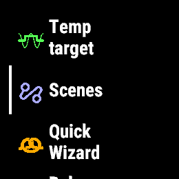
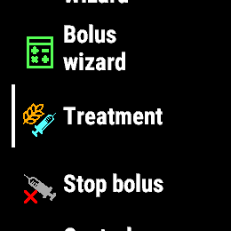
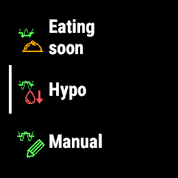
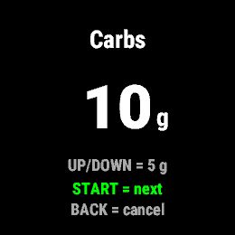
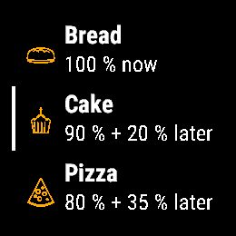
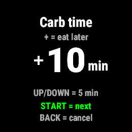
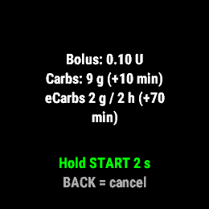
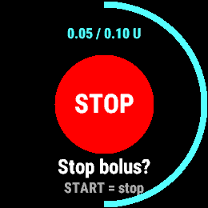

# AAPS Control - Connect IQ widget for Garmin

> **Experimental. Use it at your own risk.** This is not a medical device. It can set temp
> targets and give insulin and carbs through AAPS. Always check AAPS before and after a
> command, and never repeat a command whose result you do not know.

A Connect IQ widget for Garmin watches with a round display of 260x260 or larger and
START, BACK, UP and DOWN buttons (see [Supported watches](#supported-watches)) that
sends commands to AndroidAPS (AAPS): temp target, scenes, Quick Wizard, bolus wizard,
treatment (insulin and/or carbs) and stop bolus.
It talks to the local HTTP server of the AAPS Garmin plugin.

The widget never computes a dose. Every command is two steps: the widget asks AAPS to
*prepare* it, AAPS checks it against its own limits and settings and answers with its own
confirmation lines, the watch shows those lines verbatim, and nothing is sent until you
confirm on the watch.

---

## Screenshots

Forerunner 955 in the Connect IQ simulator.

<table>
<tr>
<td><br>Main menu</td>
<td><br>Main menu, lower part</td>
<td><br>Temp target menu</td>
</tr>
<tr>
<td><br>Bolus wizard: carbs</td>
<td><br>Bolus wizard: meal type</td>
<td><br>Bolus wizard: carb time</td>
</tr>
<tr>
<td><br>AAPS confirmation, hold START 2 s</td>
<td><br>Stop screen with bolus progress ring</td>
<td></td>
</tr>
</table>

## Requirements

- **AAPS built from the fork branch
  [`GarminPush+Steps+Control-V4.0.0-rc1`](https://github.com/Pwb0186/AndroidAPS/tree/GarminPush+Steps+Control-V4.0.0-rc1)**
  (on AAPS `4.0.0-rc1`). Stock AAPS has no watch commands.
- In AAPS: the **Garmin** plugin enabled with **Local HTTP server** on (port `28891`).
- In AAPS' Garmin settings, a **Garmin watch control key** of **8-16 digits** (digits
  only, since the watch can only type digits; AAPS needs at least 8 characters).
  That key alone unlocks temp targets and scenes. Carbs and bolus (Quick Wizard, bolus
  wizard, treatment) also need **Allow carbs and bolus from Garmin watch** (off by
  default).
- The same key typed in on the watch, see [Control key](#control-key).
- A supported watch (see [Supported watches](#supported-watches)), Connect IQ API level 5
  (`minSdkVersion` 5.0.0). Built with Connect IQ SDK 9.2.0.

---

## Supported watches

The widget builds for the Garmin watches in the Connect IQ SDK that have a round display of
260x260 or larger, Connect IQ API level 5 or newer, and the START, BACK, UP and DOWN buttons
it is controlled with. It has **only been tested on a Forerunner 955**; on the other
watches it should work the same way, but that has not been checked.

| Resolution | Device id | Watch |
|---|---|---|
| 260x260 | `fenix7` | fēnix 7 / quatix 7 |
| 260x260 | `fenix7pro` | fēnix 7 Pro |
| 260x260 | `fenix7pronowifi` | fēnix 7 Pro - Solar Edition (no Wi-Fi) |
| 260x260 | `fenix8solar47mm` | fēnix 8 Solar 47mm |
| 260x260 | `fenix9prosolar47mm` | fēnix 9 Pro Solar 47mm |
| 260x260 | `fr255` | Forerunner 255 |
| 260x260 | `fr255m` | Forerunner 255 Music |
| 260x260 | `fr955` | Forerunner 955 / Solar |
| 280x280 | `enduro3` | Enduro 3 |
| 280x280 | `enduro4` | Enduro 4 |
| 280x280 | `fenix7x` | fēnix 7X / tactix 7 / quatix 7X Solar / Enduro 2 |
| 280x280 | `fenix7xpro` | fēnix 7X Pro |
| 280x280 | `fenix7xpronowifi` | fēnix 7X Pro - Solar Edition (no Wi-Fi) |
| 280x280 | `fenix8solar51mm` | fēnix 8 Solar 51mm / tactix 8 Solar 51mm |
| 280x280 | `fenix9prosolar51mm` | fēnix 9 Pro Solar 51mm |
| 360x360 | `fr265s` | Forerunner 265s |
| 390x390 | `epix2pro42mm` | epix Pro (Gen 2) 42mm |
| 390x390 | `fr165` | Forerunner 165 |
| 390x390 | `fr165m` | Forerunner 165 Music |
| 390x390 | `fr170` | Forerunner 170 |
| 390x390 | `fr170m` | Forerunner 170 Music |
| 390x390 | `fr57042mm` | Forerunner 570 42mm |
| 390x390 | `fr70` | Forerunner 70 |
| 390x390 | `instinct3amoled45mm` | Instinct 3 AMOLED 45mm |
| 390x390 | `instinctcrossoveramoled` | Instinct Crossover AMOLED |
| 390x390 | `marq2` | MARQ (Gen 2) Athlete / Adventurer / Captain / Golfer / Carbon Edition / Commander - Carbon Edition |
| 390x390 | `marq2aviator` | MARQ (Gen 2) Aviator |
| 416x416 | `d2mach1` | D2 Mach 1 |
| 416x416 | `epix2` | epix (Gen 2) / quatix 7 Sapphire |
| 416x416 | `epix2pro47mm` | epix Pro (Gen 2) 47mm / quatix 7 Pro |
| 416x416 | `fenix843mm` | fēnix 8 43mm |
| 416x416 | `fenix943mm` | fēnix 9 43mm |
| 416x416 | `fenix9pro43mm` | fēnix 9 Pro 43mm |
| 416x416 | `fenixe` | fēnix E |
| 416x416 | `fr265` | Forerunner 265 |
| 416x416 | `instinct3amoled50mm` | Instinct 3 AMOLED 50mm |
| 454x454 | `d2mach2` | D2 Mach 2 |
| 454x454 | `d2mach2pro` | D2 Mach 2 Pro |
| 454x454 | `epix2pro51mm` | epix Pro (Gen 2) 51mm / D2 Mach 1 Pro / tactix 7 – AMOLED Edition |
| 454x454 | `fenix847mm` | fēnix 8 47mm / 51mm / tactix 8 47mm / 51mm / quatix 8 47mm / 51mm |
| 454x454 | `fenix8pro47mm` | fēnix 8 Pro 47mm / 51mm / MicroLED / quatix 8 Pro 47mm / 51mm |
| 454x454 | `fenix947mm` | fēnix 9 47mm / 51mm |
| 454x454 | `fenix9pro47mm` | fēnix 9 Pro 47mm |
| 454x454 | `fr57047mm` | Forerunner 570 47mm |
| 454x454 | `fr965` | Forerunner 965 |
| 454x454 | `fr970` | Forerunner 970 |
| 466x466 | `fenix9pro51mm` | fēnix 9 Pro 51mm |

---

## Control key

The first time the widget opens it asks for the control key: type the same numeric code
(8-16 digits) that is set as **Garmin watch control key** in AAPS.

- UP/DOWN change the current digit (0-9, wrapping around); START adds it and starts the
  next digit at 0.
- From 8 digits on, the UP/DOWN cycle also has a green check mark after 9. START on it
  saves the key and opens the menu. At 16 digits only the check mark is left.
- BACK deletes the last digit. BACK with no digits leaves without saving: back to the
  menu if a key is already stored, otherwise out of the widget.
- Only the last 4 digits are shown in clear, the rest as `*`.

To change it later, choose **Control key** at the bottom of the main menu; the entry
starts empty and the old key is kept until the new one is saved. If a command shows
"Wrong control key" or "No control key set in AAPS", check the key in AAPS and on the
watch.

The key is stored on the watch only (in the widget's storage), never in the source or in
the `.prg`. Deleting the widget from the watch deletes the key.

No ready-built `.prg` is published: build the widget yourself (see
[Build and install](#build-and-install)), so you know what runs on your watch.

---

## Menu

When the widget opens it shows "Loading..." and asks AAPS for its status (`/status`). The
answer decides which items are shown; if the status can not be read, every item is shown,
so Stop bolus can always be reached. The menu is a snapshot from when the widget opened;
AAPS still refuses whatever no longer applies.

1. **Temp target** - Activity, Eating soon and Hypo (the AAPS presets), and **Manual**:
   the target in AAPS' unit (4.0-10.0 mmol/L in 0.1 steps, starting at 7.0, or 72-180 mg/dL
   in 1 steps, starting at 126), then the duration (15-720 min in 15 min steps, starting
   at 60). **Cancel TT** is only shown when a temp target is running.
2. **Scenes** - the scenes set up in AAPS, with **End &lt;scene&gt;** at the top when one is
   running. Shown only when AAPS has scenes or one is running.
3. **Quick Wizard** - the Quick Wizard buttons AAPS reports as active now. Shown only when
   there is at least one and bolus is allowed from the watch.
4. **Bolus wizard** - the same steps as AAPS' bolus wizard:
   carbs (0-200 g in 5 g steps), meal type **Bread / Cake / Pizza** (cake and pizza give
   part of the carbs as extended carbs, like in AAPS; skipped at 0 g), **carb time**
   (-60 to +60 min in 5 min steps, starting at 0; + = eat later) and **percentage**
   (10-200 % in 5 % steps, starting at AAPS' default). START moves on and BACK goes back
   one screen, so pressing START all the way gives AAPS' defaults. If AAPS refuses the
   calculation (for example "No insulin required"), its message is shown and the widget
   returns to the main menu. Shown only when bolus is allowed from the watch.
5. **Treatment** - insulin (light blue, in the pump's bolus step, up to AAPS' max bolus;
   two decimals, three when the step needs them, e.g. 0.025),
   then carbs (orange, up to AAPS' max carbs). 0 U means carbs only; 0 g means insulin
   only. AAPS rounds and limits the amounts, and its confirmation lines show what will
   really be given. Shown only when carbs and bolus are allowed from the watch.
6. **Stop bolus** - always shown, always the last command. Sent at once with one press,
   even while another request is out.
7. **Control key** - type in a new control key (see [Control key](#control-key)).

BACK goes one level up; BACK in the main menu leaves the widget.

---

## Confirming

- **Temp target, scene, and carbs only (0 U):** one START press on the confirm screen.
- The confirm screen shows AAPS' own lines, except for **End scene** (AAPS has no prepare
  step for it, so the watch asks its own question) and **Stop bolus** (no confirmation at
  all, since stopping can never give insulin).
- **Anything with insulin:** hold START for 2 s. A ring along the edge fills while you
  hold, and the watch vibrates when it counts. Releasing earlier sends nothing.
- Only the START key confirms, and only a press that started on that screen: a press that
  was already down (for example from a long press in the menu) does not count. Touch,
  swipes and the menu key do nothing. If the confirm screen is covered (a notification),
  the hold is cancelled.
- BACK cancels. A confirm screen expires without sending anything: after 30 s for insulin
  and for carbs only, 60 s for temp targets and scenes (well before AAPS drops the
  prepared command).
- BACK or the timeout on a bolus/carbs confirmation tells AAPS to drop the prepared dose
  (`/bolus/discard`, AAPS dev, so SMBs resume at once); older AAPS ignores it.
- A green check mark shows that AAPS accepted the command.

## After a bolus

A red **STOP** screen stays while the bolus runs: the widget asks AAPS every 3 s and closes
the screen when AAPS says no bolus is running, and after 20 min regardless.
START stops the bolus at once; BACK closes the screen. A failed stop on the STOP screen
shows the error there and START tries again; a failed **Stop bolus** from the main menu
shows the error for 3 s and returns to the menu. Opening Quick Wizard, bolus wizard or treatment while a bolus is running
shows the STOP screen instead.

While the bolus runs, a light blue ring along the screen edge fills clockwise and the top
shows the delivered amount, e.g. `1.25 / 5.00 U`, updated every 3 s. They only move as far
as the pump reports progress to AAPS (some pumps only report at the end), and they need
AAPS from the fork branch `GarminPush+Steps+Control-V4.0.0-rc1` with this change; older
AAPS versions (and SMBs) show the STOP screen without them.

## Unknown results

Only clear refusals count as "nothing was done": a wrong or missing key, a lock after
wrong keys, or a plain error from AAPS (`ok:false` that is not marked `unknown`). Those are
shown as an error, and you can choose again. Anything else after a commit - timeout, lost
connection, an unclear answer - is treated as unknown: the widget shows
**"Unknown - do NOT repeat. Check AAPS and pump."** (vibrating, for a bolus) or "Unknown -
check AAPS" (temp target, scene) until you press the BACK key; a swipe does not close it,
so it is not dismissed unread. After an unknown bolus the STOP screen follows, in case the
bolus is running or still queued in AAPS: it only closes once AAPS has said "no bolus
running" for at least 30 s, and it stays open (still asking, START still stops) while AAPS
can not be asked. After an unknown temp target or scene, **Cancel TT** / **End scene** is
offered, since it may be running. The widget never sends a command again by itself.

## Pickers

UP/DOWN change the value exactly one step per press, however fast you press, so the value
never jumps past what you are watching. (Holding UP or DOWN is taken by the watch itself
for its menu and music controls, so there is no hold-to-repeat.)

---

## Build and install

Requirements: Connect IQ SDK and a Connect IQ developer key (SDK Manager / VS Code:
"Generate a Developer Key"). No key file is needed: the control key is typed in on the
watch.

**Command line**, from the repository root:

```
monkeyc -d fr955 -f monkey.jungle -o bin/AapsControl.prg -y <your developer key> -r
```

Replace `fr955` with the device id of your watch (see [Supported watches](#supported-watches)).
If you build it yourself, you can give it your own app id in `manifest.xml` if you want
(optional).

`-r` makes a release build. Leave it out for a debug build that logs requests (never the
key) to `GARMIN\APPS\LOGS\AAPSCONTROL.TXT`, if that file exists on the watch.

**Install (sideload):** connect the watch by USB, copy `bin/AapsControl.prg` to
`GARMIN\APPS`, and add the widget to the glance list on the watch; it shows as "AAPS".

**Simulator:** the simulator has no phone, so requests fail unless the AAPS HTTP port is
forwarded to the computer (for example `adb forward tcp:28891 tcp:28891`). Commands sent
from the simulator are real: they set real temp targets and give real boluses.

## Languages

The widget's own texts are in English. AAPS' confirmation lines and messages follow
AAPS' own language.

## Known limits

- The menu shows what AAPS reported when the widget opened. If something changes while it
  is open (for example a temp target ends), the menu is not updated, but AAPS checks again
  and refuses what is no longer possible.
- The watch's number font has no plus or minus, so the carb time sign is drawn by hand.
- Only tested on a Forerunner 955; the other supported watches have not been tested.
- The menu icons are 40 px on every watch, so they look smaller on the larger screens.

---

## Credits and license

The icons come from [AndroidAPS](https://github.com/nightscout/AndroidAPS) (AGPL-3.0):
the AAPS app icon, the temp target, Quick Wizard, calculator, automation, bolus and meal
type icons, and the Wear treatment icon, converted to 40 px PNGs for the watch.
The control key icon is the "key" icon from Google's
[Material Symbols](https://github.com/google/material-design-icons) (Apache-2.0).

Because it ships those icons, this repository is licensed under the GNU Affero General
Public License v3.0; see [LICENSE](LICENSE).
